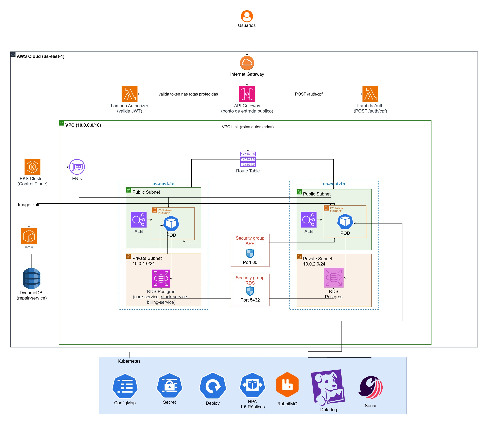

# mechanical-hub-core-service

Microsserviço central do **Mechanical Hub** (Fase 4 — Tech Challenge): dono do cadastro de clientes/veículos, do ciclo de vida da Ordem de Serviço (OS) e do **orquestrador do Saga Pattern** que coordena os outros 3 microsserviços (`repair-service`, `billing-service`, `stock-service`).

Nasceu da quebra do monolito `mechanical-hub` (Fases 1–3) em microsserviços, seguindo a decomposição por domínio de dados documentada em [`docs/adrs.md`](docs/adrs.md) (ADR-001).

## Diagrama de infraestrutura



## Arquitetura

Clean Architecture (`domain` / `application` / `infrastructure`), mesmo padrão das fases anteriores:

- **domain** — entidades (`ServiceOrder`, `Customer`, `Vehicle`, `User`, `SagaState`), enums de status e as estratégias de transição de status (`domain/strategies/order_transition`, uma classe por transição possível — `Strategy pattern`, cada transição valida seu próprio estado de origem).
- **application** — casos de uso e controllers REST internos (`ServiceOrderController`, `CustomerController`, `VehicleController`), e o **`SagaOrchestratorUseCase`** — o coração do orquestrador.
- **infrastructure** — JPA/Postgres, segurança (JWT stateless, sem sessão), mensageria (RabbitMQ via Spring AMQP), métricas (Micrometer → statsd → Datadog).

### Saga Pattern (RFC-001)

O Saga é **orquestrado** (não coreografado) e vive embutido neste serviço, com estado explícito numa tabela própria (`SagaState`: `serviceOrderId`, `etapaAtual`). A justificativa completa está em [`docs/rfcs.md`](docs/rfcs.md) (RFC-001).

O Saga **não começa na criação da OS** — só quando o mecânico move a OS manualmente pra "Aguardando aprovação" (`PATCH /service-orders/{id}/status`), evitando uma race condition entre esse pedido e a resposta do billing-service.

**Publica** (routing keys na exchange `saga.exchange`):
| Evento | Quando |
|---|---|
| `orcamento.solicitado` | Mecânico move a OS pra "Aguardando aprovação" |
| `execucao.revertida` | Execução falhou, material reservado precisa ser liberado |

**Consome** (fila `core-service.eventos.queue`):
| Evento | Origem | Efeito |
|---|---|---|
| `orcamento.gerado` | billing-service | Atualiza o valor do orçamento |
| `orcamento.aprovado` / `orcamento.recusado` | billing-service | `APROVADO` / `RECUSADO` |
| `pagamento.confirmado` / `pagamento.falhou` | billing-service | `PAGAMENTO_REALIZADO` / `FALHA_PAGAMENTO` |
| `material.reservado` / `material.indisponivel` | repair-service | `PRONTO_PARA_EXECUCAO` / `PENDENTE_ESTOQUE` |
| `execucao.iniciada` | repair-service | `EM_EXECUCAO` (primeira tarefa iniciada pelo mecânico) |
| `execucao.finalizada` / `execucao.falhou` | repair-service | `FINALIZADO` / volta pra `EM_DIAGNOSTICO` |

Mensagens que caem numa transição de status inválida (`InvalidOrderTransitionException`) são descartadas com log, não reentregues indefinidamente — ver ADR/incidente documentado no histórico do projeto (loop de reentrega real, corrigido).

**Diagrama do fluxo** (quem dispara, pra qual fila cai, REST síncrono vs evento assíncrono):

```mermaid
flowchart TD
    subgraph Gatilhos["Gatilhos manuais / externos"]
        M1["Mecânico: PATCH /service-orders/{id}/status → Aguardando aprovação"]
        C1["Cliente: POST /budgets/{id}/approve ou /reject"]
        MP["Mercado Pago: POST /webhooks/mercadopago"]
        M2i["Mecânico: PATCH tarefa → INICIADO (1ª da OS)"]
        M2f["Mecânico: PATCH tarefa → FINALIZADO (última pendente)"]
        M3["Mecânico: POST .../execution-failure"]
        A1["Admin: POST /stock/entry"]
    end

    subgraph Exchange["RabbitMQ — saga.exchange (topic)"]
        EX((saga.exchange))
    end

    subgraph CoreSvc["core-service — Orquestrador do Saga"]
        CQ[["core-service.eventos.queue"]]
        SAGA["SagaOrchestratorUseCase"]
        CQ --> SAGA
    end

    subgraph BillingSvc["billing-service"]
        BQ[["billing-service.eventos.queue"]]
        BL["Orçamento + Mercado Pago"]
        BQ --> BL
    end

    subgraph RepairSvc["repair-service"]
        RQ[["repair-service.eventos.queue"]]
        RL["Reserva de material + tarefas"]
        RQ --> RL
    end

    subgraph StockSvc["stock-service"]
        ST["Reserva / baixa / entrada"]
    end

    M1 --> SAGA
    SAGA -- "publica: orcamento.solicitado" --> EX
    EX -- "orcamento.solicitado" --> BQ

    BL -- "publica: orcamento.gerado" --> EX
    EX -- "orcamento.gerado" --> CQ

    C1 --> BL
    BL -- "publica: orcamento.aprovado / orcamento.recusado" --> EX
    EX -- "orcamento.aprovado / orcamento.recusado" --> CQ

    MP --> BL
    BL -- "publica: pagamento.confirmado / pagamento.falhou" --> EX
    EX -- "pagamento.confirmado / pagamento.falhou" --> CQ
    EX -- "pagamento.confirmado" --> RQ

    RL -- "REST síncrono: POST /stock/reservations" --> ST
    ST -. "resposta síncrona" .-> RL
    RL -- "publica: material.reservado / material.indisponivel" --> EX
    EX -- "material.reservado / material.indisponivel" --> CQ

    A1 --> ST
    ST -- "publica: estoque.reabastecido" --> EX
    EX -- "estoque.reabastecido" --> RQ

    M2i --> RL
    RL -. "REST síncrono: GET /service-orders/{id}/status" .-> SAGA
    RL -- "publica: execucao.iniciada (só a 1ª tarefa)" --> EX
    EX -- "execucao.iniciada" --> CQ

    M2f --> RL
    RL -- "publica: execucao.finalizada" --> EX
    EX -- "execucao.finalizada" --> CQ

    M3 --> RL
    RL -- "publica: execucao.falhou" --> EX
    EX -- "execucao.falhou" --> CQ

    SAGA -- "publica: execucao.revertida" --> EX
    EX -- "execucao.revertida" --> ST
```



### Máquina de estados da OS

`RECEBIDO → EM_DIAGNOSTICO → AGUARDANDO_APROVACAO → APROVADO → PAGAMENTO_REALIZADO → (PENDENTE_ESTOQUE ⇄) → PRONTO_PARA_EXECUCAO → EM_EXECUCAO → FINALIZADO → ENTREGUE`

(com desvios pra `RECUSADO` e `FALHA_PAGAMENTO`, ambos recuperáveis)

## Tecnologias

- Java 21 / Spring Boot 3.2
- PostgreSQL (RDS, `core_service_db`) via Spring Data JPA + Flyway
- RabbitMQ (Spring AMQP)
- Spring Security (JWT stateless, sem `UserDetailsService`/sessão)
- Datadog (`dd-java-agent` + Micrometer/statsd) — tracing distribuído e métricas
- springdoc-openapi (Swagger UI)
- JUnit 5 + Mockito + AssertJ + **Cucumber-JVM** (BDD)

## Rodando localmente

```bash
./mvnw spring-boot:run
```

Requer as variáveis de ambiente de `k8s/configmap.yaml`/`k8s/secret.yaml` (`DB_HOST`, `DB_PORT`, `DB_NAME`, `DB_USERNAME`, `DB_PASSWORD`, `RABBITMQ_HOST`, `JWT_SECRET`, etc.).

Swagger UI: `http://localhost:8080/swagger-ui/index.html`

## Testes

```bash
./mvnw test
```

**286 testes**, **87% de cobertura** (gate do SonarQube: 80% em código novo). Inclui um cenário BDD completo (`src/test/resources/features/saga-fluxo-completo.feature`) cobrindo o fluxo de ponta a ponta da OS através do Saga, com os use cases reais ligados a fakes em memória — só a entrega dos eventos externos é simulada, nunca a lógica de decisão.

## Deploy

- `Dockerfile` multi-stage (build Maven → runtime `eclipse-temurin:21-jre-jammy`, com `dd-java-agent` injetado)
- `k8s/` — namespace, configmap, secret, deployment, service (NodePort `30081`), HPA
- CI/CD (`.github/workflows/`): `feature.yml` (build → testes → SonarQube com gate → PR) e `main.yml` (build da imagem → push ECR → deploy no EKS)

Exposto publicamente via API Gateway (ALB) nos paths `/auth/login`, `/service-orders*`, `/customers*`, `/vehicles*`.

## Documentação de arquitetura

- [ADRs](docs/adrs.md) — decomposição em microsserviços, RabbitMQ, DynamoDB, SonarQube self-hosted, Java/Spring, Cucumber-JVM, AWS Academy
- [RFCs](docs/rfcs.md) — escolha do Saga orquestrado vs. coreografado
